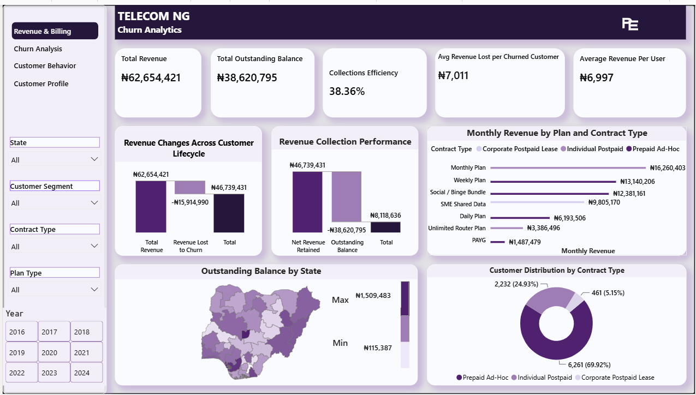
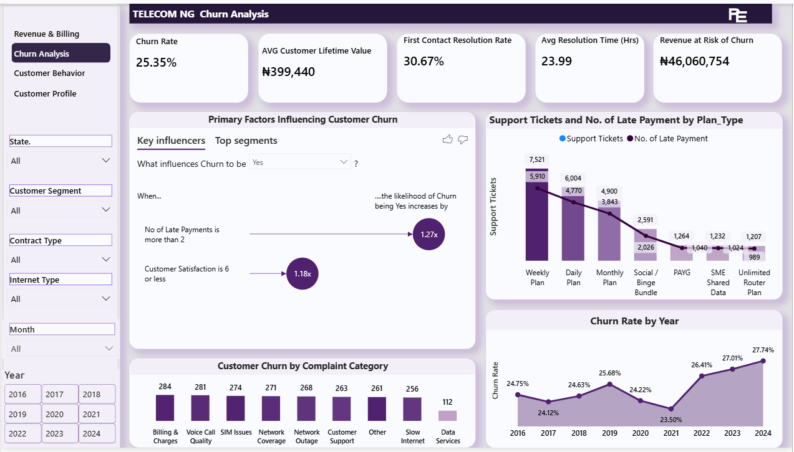
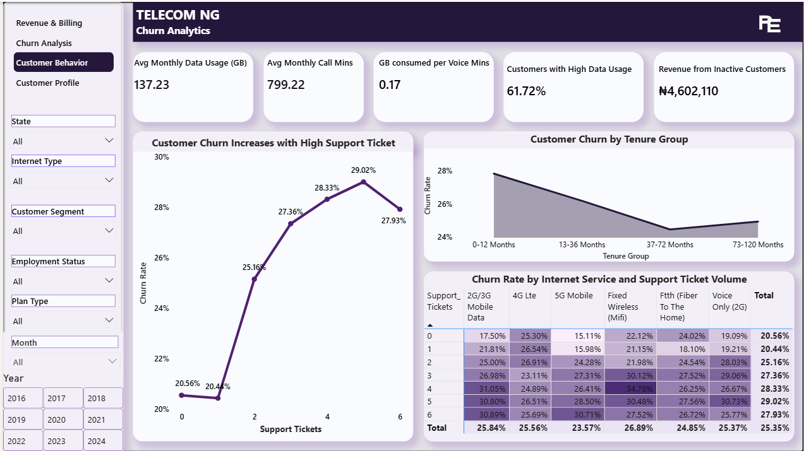
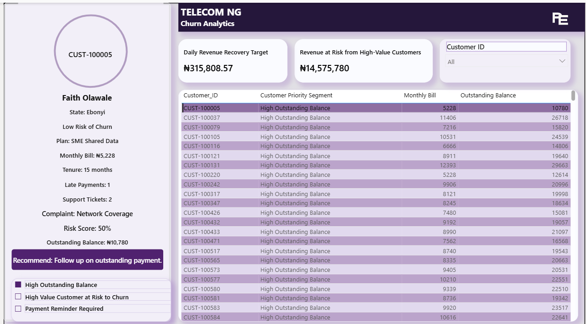

# Telecom NG Customer Churn Analytics: A Power BI Dashboard and a Churn Model on a Synthetic Dataset

**Author:** Peace Mmesoma Ekete
**Tools:** Python (pandas, scikit-learn), Microsoft Power BI (Power Query and DAX)
**Notebook:** `Python_Data_Cleaning_Portfolio.ipynb`
**Dashboard pages:** Revenue & Billing, Churn Analysis, Customer Behavior, Customer Profile

The project has a notebook, a Power BI file, this README, a DAX measures file and screenshots of the four dashboard pages (`Revenue-and-billing.png`, `Churn-analysis.png`, `Customer-behavior.png` and `Customer-profile.png`). The notebook reads the raw file `TelecomChurn_Nigeria_Raw.csv` and saves the cleaned file `TelecomChurn_Nigeria_Clean.csv`, which is the data behind the dashboard.

**About the data.** The data is synthetic. The raw file is a generated dataset, not data from a real telecom company. In the notebook I rebuilt several fields with rules and random numbers (Section 5.3). This project shows how I clean data, build measures and design a dashboard. The numbers describe this dataset, not a real business.

## 1. Introduction

Customer churn means customers leaving. For a telecom company, every customer who leaves takes monthly revenue with them, and winning a new customer costs money.

This project looks at churn in a synthetic Nigerian telecom dataset. I cleaned the data in Python, trained a logistic regression model, and built a four page Power BI dashboard on revenue and billing, the factors linked to churn, customer behaviour and individual customer profiles.

The project is a portfolio exercise. It was not tested with a real telecom company.

## 2. Problem Statement

A telecom company has a lot of customer data, but a table of numbers does not tell a retention team who to call or what to look at first. The problem is finding which customers are most likely to churn, how much revenue that puts at risk, and which customer information is linked to leaving.

The project answers these questions:

| Question | Answer |
|---|---|
| How many customers and how much revenue does the dashboard cover? | 8,954 customers who joined between 2016 and 2024, with ₦62.65M in monthly revenue (the total of Monthly_Bill). |
| How much revenue is lost to churn? | The churn rate is 25.35%, which is 2,270 customers. Their monthly bills add up to ₦15.91M, or 25.4% of monthly revenue. |
| Which plans bring in the most revenue? | Monthly Plan (₦16.26M), then Weekly Plan (₦13.14M) and Social / Binge Bundle (₦12.38M). |
| Which customers are most likely to churn? | Customers with more support tickets (27.4% at 3 tickets, 29.0% at 5, against 20.4% to 20.6% at 0 or 1), more late payments and lower satisfaction. Customers with a Risk_Score of 100 churn at 29.4%. |
| What factors have the strongest link to churn? | More than 2 support tickets (1.28 times), more than 2 late payments (1.27 times) and a satisfaction score of 6 or less (1.18 times). |
| How do payment behaviour, complaints, support tickets and service usage relate to churn? | Late payments raise churn, and paying by auto debit makes no difference (0.99 times). Support tickets raise churn from about 20% to 29%. Churn by internet type runs from 23.57% (5G Mobile) to 26.89% (Fixed Wireless). Complaint categories are shown as counts, not rates. |
| Can a model predict which customers will churn? | Not well. The logistic regression model has an accuracy of 50.40% and a ROC-AUC of 0.57 (0.50 is guessing). It is not part of the dashboard. |
| Which customers should be prioritized for retention, and what action fits each group? | High value customers at risk get a retention call, customers with a high outstanding balance get a payment follow up, and customers who need a payment reminder get a reminder. |

## 3. Aim and Objectives

**Aim:** To clean a telecom customer dataset, train a model that predicts churn, and build a dashboard that shows revenue, billing and churn in one place.

**Objectives:**

1. Load the dataset and check its size, structure and missing values.
2. Clean the data and record how many rows and values each step changed.
3. State which fields come from the raw data and which are built by rules.
4. Train a logistic regression model on the cleaned data and report its results.
5. Build a dashboard that answers the questions in Section 2, including a page for one customer's profile.

## 4. Dataset Description

**Source.** The raw file is `TelecomChurn_Nigeria_Raw.csv`, a synthetic dataset. Before cleaning it has 10,150 rows and 40 columns. Each row is one customer. After cleaning there are 10,000 rows and 39 columns.

**Columns used in the dashboard.**

| Column | What it holds |
|---|---|
| Customer_ID | The customer, in the format CUST-xxxxxx. |
| State | The state the customer is in. |
| Customer_Since | The date the customer joined. |
| Plan_Type | The subscription plan. |
| Contract_Type and Customer_Segment | Prepaid or postpaid, and a customer group (both rebuilt by rules, see 5.3). |
| Internet_Type | 2G/3G Mobile Data, 4G LTE, 5G Mobile, Fixed Wireless (MiFi), FTTH (Fiber to the Home) or Voice Only (2G). |
| Monthly_Bill | What the customer is billed each month. Dashboard revenue is the total of this column. |
| Outstanding_Balance | Money the customer owes (rebuilt by rules, see 5.3). |
| Late_Payment_Count and Support_Tickets | Counts of late payments and support tickets. |
| Customer_Satisfaction and NPS_Score | Satisfaction (1 to 10) and Net Promoter Score. |
| Mobile_App_Login_Last30Days | App logins in the last 30 days. |
| Monthly_Data_Usage_GB and Monthly_Call_Minutes | Data and call usage. |
| Complaint_Category and Average_Resolution_Time | The type of complaint and the resolution time in hours. |
| Risk_Score and Estimated_CLV | A risk score from 0 to 100 and an estimated customer lifetime value (both built by rules, see Section 6). |
| Churn | Yes if the customer left, No if the customer stayed. |

## 5. Data Cleaning

I cleaned the data in a Python notebook, then did the rest in Power BI.

### 5.1 Rows

| Step | Rows left | Rows removed |
|---|---|---|
| Raw file loaded (40 columns) | 10,150 | |
| Duplicate Customer_IDs removed | 10,000 | 150 |
| Customers who joined before 2016 or after 2024 left out of the dashboard | 8,954 | 1,046 |

**Duplicates (150 rows).** Every ID was put in the format CUST-xxxxxx. Rows were matched on Customer_ID only, and the first row for each ID was kept.

**Years left out (1,046 customers).** The years before 2016 and after 2024 are incomplete, so customers who joined in those years are left out of the dashboard. The model in Section 7 uses all 10,000 customers.

### 5.2 Missing values

Placeholders such as N/A, NULL and blank spaces were turned into real missing values first. These were the counts before cleaning:

| Column | Missing | Share of 10,150 |
|---|---|---|
| Monthly_Income | 1,086 | 10.7% |
| Estimated_CLV | 934 | 9.2% |
| Outstanding_Balance | 866 | 8.5% |
| Monthly_Bill | 861 | 8.5% |
| Discount_Applied | 500 | 4.9% |
| Complaint_Category | 494 | 4.9% |
| Customer_Satisfaction | 490 | 4.8% |
| Marital_Status | 414 | 4.1% |
| Customer_Since | 403 | 4.0% |
| Roaming_Usage | 396 | 3.9% |
| Email_Open_Rate | 385 | 3.8% |
| Employment_Status | 320 | 3.2% |
| Gender | 124 | 1.2% |

Missing numbers were filled with the column median. Every missing Monthly_Bill became ₦5,228 and every missing Monthly_Income became ₦119,347.50, which is about 8.5% of bills and about 11% of incomes. Missing text values became Unknown. After cleaning, no values are missing.

### 5.3 Fields built by rules

Several columns do not come from the raw data. They were rebuilt in the notebook. The random numbers use a fixed seed (42), so running the notebook again gives the same values.

| Field | What was done | Rows affected |
|---|---|---|
| Outstanding_Balance | Every value was replaced. Postpaid customers get their Monthly_Bill times a random number between 0.1 and 2.5. Prepaid customers get 0. | All 10,000 (3,007 postpaid, 6,993 prepaid) |
| Contract_Type and Customer_Segment | Rebuilt from Plan_Type. SME plans became Corporate Postpaid Lease. Monthly and Unlimited plans became Individual Postpaid. Everything else became Prepaid Ad-hoc. Every Monthly Plan customer became a High Value Customer. | All 10,000 |
| Plan_Type | The raw tiers were renamed to retail plan names (for example Basic became Daily Plan and Premium became Monthly Plan). | All 10,000 |
| Internet_Type | The raw labels were renamed (for example DSL became 2G/3G Mobile Data and Fiber became FTTH). Voice Only customers have data usage and streaming set to 0. | All 10,000 |
| Risk_Score | Built from a formula (Section 6). | All 10,000 |
| Estimated_CLV | Replaced with a formula (Section 6). | All 10,000 |
| Tenure_Months | Recalculated from Customer_Since. Then 5G customers with more than 48 months got a random tenure of 12 to 48 months, and 4G customers with more than 110 months got a random tenure of 24 to 110 months. | 1,222 (1,032 and 190) |
| Monthly_Income | Incomes under ₦35,000 were replaced with a random value from ₦35,000 to ₦75,000. Consumer incomes over ₦1.5M were replaced with a random value from ₦500,000 to ₦1.2M. | 1,412 (1,323 and 89) |
| Support_Tickets and Late_Payment_Count | Tickets were divided by 4 and late payments by 3, keeping whole numbers. | All 10,000 |

Charts built on these fields show these rules, not real customer behaviour. That covers outstanding balances, contract type, customer segment, tenure for 12% of customers, income, risk score and lifetime value.

### 5.4 Other cleaning steps

- Fixed typos in gender, marital status, plan names and state names (for example Bornu became Borno, Kanno became Kano and FCT became Abuja). Gender has 391 Unknown values and marital status has 408.
- Removed the ₦ and NGN markers and commas from money columns, and treated negative amounts as missing.
- Set ages under 16 or over 90 to missing, then filled them with the median age of 47. Ages run from 18 to 75.
- Changed Employment_Status to Self-Employed for students and interns over 30.
- Turned Customer_Since into real dates. The 398 missing dates were rebuilt from Tenure_Months, using 1 June 2025 as the reference date.
- Cleaned the email open rate and the add on subscription text, and put Yes and No fields in a standard format.
- Average_Resolution_Time has some negative values in the raw data. They stay in the file and the dashboard measure ignores them.

## 6. How Risk_Score and Estimated_CLV Are Built

**Risk_Score** is a formula, not a prediction. It adds late payments times 30, a small term for the outstanding balance compared with the largest bill, and support tickets times 5. The result is capped at 100 and kept as a whole number. Churn is not part of the formula.

Because late payments carry so much weight, the score fills up quickly:

- The average is 70.3, and the median is 85.
- 40.29% of customers have a score of exactly 100.
- 69.31% of customers have a score above 50.

Churn rate by score band:

| Risk_Score band | Churn rate |
|---|---|
| 0 to 25 | 21.1% |
| 26 to 50 | 20.7% |
| 51 to 75 | 24.2% |
| 76 to 99 | 24.5% |
| 100 | 29.4% |

Customers at 100 churn at 29.4%, against 20.7% to 24.5% in the other bands.

**Estimated_CLV** is also a formula. It takes Monthly_Bill times Tenure_Months, then adds Monthly_Bill times 0.35 times a projected number of months. The projected months are 3 if the Risk_Score is above 50 and 24 if it is not. The original CLV values in the raw file are not used.

## 7. Churn Model

A logistic regression model was trained to test whether customer details can predict churn. It is separate from the dashboard. The cleaned file is saved before the model is trained, and the dashboard measures use Risk_Score and not model predictions.

**Setup.** The target is Churn (Yes is 1, No is 0). The nine inputs are Age, Monthly_Income, Monthly_Data_Usage_GB, Monthly_Bill, Risk_Score, Customer_Satisfaction, NPS_Score, Mobile_App_Login_Last30Days and Tenure_Months. The 10,000 rows are split into 8,000 for training and 2,000 for testing (random_state 42). The inputs are scaled with StandardScaler, fitted on the training rows only. The model uses `class_weight="balanced"` because only 25.25% of the test customers churned.

**Results on the 2,000 test customers.**

| | Not churn | Churn |
|---|---|---|
| Precision | 0.79 | 0.29 |
| Recall | 0.46 | 0.65 |
| F1 score | 0.58 | 0.40 |
| Customers in the test set | 1,495 | 505 |

| Confusion matrix | Predicted not churn | Predicted churn |
|---|---|---|
| Actually not churn | 681 | 814 |
| Actually churn | 178 | 327 |

Accuracy is 50.40% and ROC-AUC is 0.5685.

**What the results show.**

- A model that said "no churn" for every customer would be right 74.75% of the time. This model is right 50.40% of the time, so accuracy is not a useful measure here.
- The model marked 1,141 of the 2,000 customers as churn and caught 327 of the 505 who churned. 29% of the customers it marked actually churned, against 25.25% in the whole test set.
- A ROC-AUC of 0.57 is close to 0.50, which is guessing.
- Only Risk_Score has a coefficient clearly away from zero (0.18). Customer satisfaction is next at -0.08, and every other input is between -0.04 and 0.01. Risk_Score is built from late payments, balances and tickets, so the model's strongest input is itself a formula of those fields.

The model shows the method. It is not used for any business figure in the dashboard.

## 8. How the Dashboard Measures Work

The full DAX is in the DAX measures file in this repository. These are the main measures in plain words.

| Measure | How it is worked out |
|---|---|
| Churn Rate | Churned customers divided by all customers (25.35%). |
| Monthly Revenue (shown as Total Revenue) | The total of Monthly_Bill. |
| Revenue Lost to Churn | The total Monthly_Bill of customers who churned. It is one month of billing, not lifetime value. |
| Average Revenue Per User | Monthly Revenue divided by all customers. |
| Collections Efficiency | (Total Monthly_Bill minus total Outstanding_Balance) divided by total Monthly_Bill. It compares the balances owed with one month of billing. The balances come from the rules in Section 5.3. |
| First Contact Resolution Rate | The share of customers with 0 or 1 support tickets. The data has no field that records whether a problem was solved on first contact, so the card uses ticket count. |
| Avg Resolution Time (Hrs) | The average of Average_Resolution_Time, ignoring negative values. |
| Revenue from Inactive Customers | The Monthly_Bill of customers who have not churned and had 0 app logins in the last 30 days. |
| Churn Risk Status | High Risk of Churn if Risk_Score is 90 or more, Moderate if it is 60 to 89, Low if it is below 60. |
| Revenue at Risk of Churn | The Monthly_Bill of customers who have not churned and have a Risk_Score of 90 or more. |
| Revenue at Risk from High-Value Customers | Outstanding_Balance plus Monthly_Bill, added up for customers with a Risk_Score of 70 or more and a Monthly_Income of ₦250,000 or more. It adds money owed to one month of billing, so it shows exposure, not monthly revenue. |
| Daily Revenue Recovery Target | 65% of Revenue at Risk from High-Value Customers, divided by 30 days. The 65% is an assumption. |
| Customer Priority Segment | See below. |

**Customer Priority Segment.** Each customer gets the first group that fits:

1. High Value Customer at Risk to Churn: Risk_Score of 90 or more and a Monthly_Bill of ₦15,000 or more. Recommended action: retention call.
2. High Outstanding Balance: a balance above 0 that is at least twice the Monthly_Bill. Recommended action: follow up on the payment.
3. Payment Reminder Required: Risk_Score below 50, at least 1 late payment and a balance above 0. Recommended action: send a reminder.
4. No Immediate Action Required.

The Risk_Score cutoffs differ by measure: 90 for high risk, 70 for high value exposure and 50 for payment reminders. Risk_Score is capped at 100 and the median is 85, so the cutoffs sit high on the scale.

## 9. Dashboard Pages and Findings

### 9.1 Revenue & Billing

*Figure 1: Revenue & Billing page.* The cards show total revenue, outstanding balance, collections efficiency, average revenue lost per churned customer and average revenue per user. The charts show revenue lost to churn, revenue by plan and contract type, outstanding balance by state and customers by contract type.

- Total monthly revenue is ₦62,654,421. Customers who churned account for ₦15,914,990 of it (25.4%), which leaves ₦46,739,431 from customers who stayed.
- Average revenue per user is ₦6,997, and the average lost per churned customer is ₦7,011. Customers who churned paid about the same as everyone else.
- Revenue by plan: Monthly Plan ₦16.26M, Weekly Plan ₦13.14M, Social / Binge Bundle ₦12.38M, SME Shared Data ₦9.81M, Daily Plan ₦6.19M, Unlimited Router Plan ₦3.39M and PAYG ₦1.49M.
- Contract types: Prepaid Ad-Hoc 6,261 customers (69.92%), Individual Postpaid 2,232 (24.93%) and Corporate Postpaid Lease 461 (5.15%). This split comes straight from the plan rules in Section 5.3.
- Total outstanding balance is ₦38,620,795, and by state it runs from ₦115,387 to ₦1,509,483. These balances are generated by the rules in Section 5.3.

### 9.2 Churn Analysis

*Figure 2: Churn Analysis page.* The cards show the churn rate, average customer lifetime value, first contact resolution rate, average resolution time and revenue at risk of churn.

- The churn rate is 25.35%. Average customer lifetime value is ₦399,440, which comes from the formula in Section 6.
- The first contact resolution rate is 30.67%, and the average resolution time is 23.99 hours.
- **Factors linked to churn:** customers with more than 2 support tickets churn 1.28 times as often as other customers. For more than 2 late payments it is 1.27 times, and for a satisfaction score of 6 or less it is 1.18 times. Customers who pay by auto debit churn at 0.99 times the rate of others, which is no difference.
- The complaint category chart shows counts of churned customers, not rates. Eight categories sit between 256 and 284, and Data Services is lower at 112.
- The support tickets and late payments chart shows totals by plan. Weekly Plan has the most tickets (7,521) and late payments (5,910), which follows the number of customers on each plan.
- Each year in the revenue and churn chart is the group of customers who joined that year. Customers who joined in 2022, 2023 and 2024 churned at 26.41%, 27.01% and 27.74%. Customers who joined between 2016 and 2021 churned at between 23.50% and 25.68%.

### 9.3 Customer Behavior

*Figure 3: Customer Behavior page.* The cards show data usage, call minutes, high data usage and inactive customer revenue. The charts show churn by support tickets, tenure group and internet type.

- Average monthly data usage is 137.23 GB and average monthly call time is 799.22 minutes. Both are far above real world levels.
- The Customers with High Data Usage card shows 61.72%.
- Revenue from active customers with no app login in the last 30 days is ₦4,602,110.
- Churn goes up with support tickets: 20.56% with 0 tickets, 20.44% with 1, 25.16% with 2, 27.36% with 3, 28.33% with 4, 29.02% with 5 and 27.93% with 6. The jump comes at 2 tickets.
- Churn is highest for customers in their first 12 months and lowest for customers with 37 to 72 months. Tenure was changed by the rules in Section 5.3 for 12% of customers.
- By internet type, churn is lowest on 5G Mobile (23.57%) and highest on Fixed Wireless (26.89%), a gap of 3.3 points.

### 9.4 Customer Profile

*Figure 4: Customer Profile page.* Choosing a Customer ID fills the card on the left with the customer's details.

- The profile card shows the customer ID, name, state, risk status, plan, monthly bill, tenure, late payments, support tickets, complaint category, risk score and outstanding balance. It also shows the recommended action.
- The page has two cards: Revenue at Risk from High-Value Customers (₦14,575,780) and the Daily Revenue Recovery Target (₦315,808.57). Both depend on the generated balances and on the 65% recovery assumption.
- Where a bill was missing in the raw file, the profile shows the median bill of ₦5,228. This applies to about 8.5% of customers.

## 10. What the Dashboard Suggests

These suggestions come from a synthetic dataset.

1. Look at customers with 2 or more support tickets. Churn rises from about 20% to 25% at the second ticket and reaches 29% by the fifth. A follow up after the second ticket is a low cost test.
2. Look at customers with more than 2 late payments, who churn 1.27 times as often as others.
3. Look at customers with a satisfaction score of 6 or less, who churn 1.18 times as often.
4. Use tickets, late payments and satisfaction alongside Risk_Score and the model when deciding who to call. Risk_Score and the model each separate churners only slightly.

## 11. Limitations

- The dataset is synthetic. Usage of 137 GB a month and 799 call minutes is far above real levels.
- Outstanding_Balance, Contract_Type, Customer_Segment, Risk_Score, Estimated_CLV, part of Tenure_Months and part of Monthly_Income come from the rules in Section 5.3. Charts built on them show those rules, not customer behaviour.
- About 8.5% of Monthly_Bill values and about 11% of Monthly_Income values are the median, filled in where the raw value was missing.
- The dashboard covers 8,954 customers who joined between 2016 and 2024. The model uses all 10,000.
- The churn model has an accuracy of 50.40% and a ROC-AUC of 0.57, it was tested on one split, and it is not part of the dashboard.
- Risk_Score is capped at 100, and 40.29% of customers sit at the cap, so the score does not separate them.
- Revenue Lost to Churn is one month of billing from customers who left. It is not lifetime value.
- Collections Efficiency compares balances with one month of billing, and the balances are generated.
- The priority segments include customers who have already churned.
- Several charts show counts or totals, not rates (complaints by category, tickets by plan), so they follow the size of each group.
- The links between churn and tickets, late payments and satisfaction are links within this dataset. They do not show that one causes the other.

## 12. Conclusion

This project cleaned a synthetic telecom dataset of 10,150 rows (10,000 after removing 150 duplicates), built a four page Power BI dashboard on 8,954 customers and trained a logistic regression model. The churn rate is 25.35%, and customers with more support tickets, more late payments or lower satisfaction churn more often.

The model reached an accuracy of 50.40% and a ROC-AUC of 0.57, and it is not part of the dashboard. Balances, risk scores and lifetime value come from rules written in the notebook and not from the raw data. The dashboard demonstrates how the analysis is built and documented, and the limitations above list what it can and cannot show.

## 13. Tools and Skills Demonstrated

- **Python:** pandas, NumPy and scikit-learn for cleaning, scaling, splitting and training a logistic regression model.
- **Power BI:** a four page interactive dashboard with navigation, slicers, a map, a waterfall chart and a customer profile page.
- **DAX:** measures for churn, revenue, collections, risk groups, priority segments and recommended actions, and text measures for the profile card.
- **Data cleaning:** missing values, duplicates, typos, currency text, dates and inconsistent labels, with counts recorded at each step.
- **Model evaluation:** comparing a model with a baseline using accuracy, a confusion matrix, precision, recall and ROC-AUC.

## 14. References

1. scikit-learn documentation. https://scikit-learn.org
2. Microsoft Power BI documentation. https://learn.microsoft.com/power-bi/

## 15. How to Run the Notebook

1. Install Python and Jupyter.
2. Install the packages the notebook uses: `pip install pandas numpy scikit-learn`.
3. Put `TelecomChurn_Nigeria_Raw.csv` in the same folder as the notebook, or in a `Data` folder next to it. The notebook searches for the file by name.
4. Open `Python_Data_Cleaning_Portfolio.ipynb` and run all the cells in order. The notebook saves `TelecomChurn_Nigeria_Clean.csv` and then trains the model.
5. The random numbers in Section 5.3 use a fixed seed, so the cleaned file and the model results are the same each time.

The Power BI file keeps its own copy of the cleaned data, so it opens without running the notebook.

## Connect With Me

- LinkedIn: https://linkedin.com/in/ekete-peace-a7837b275
- Email: peaceekete8@gmail.com
